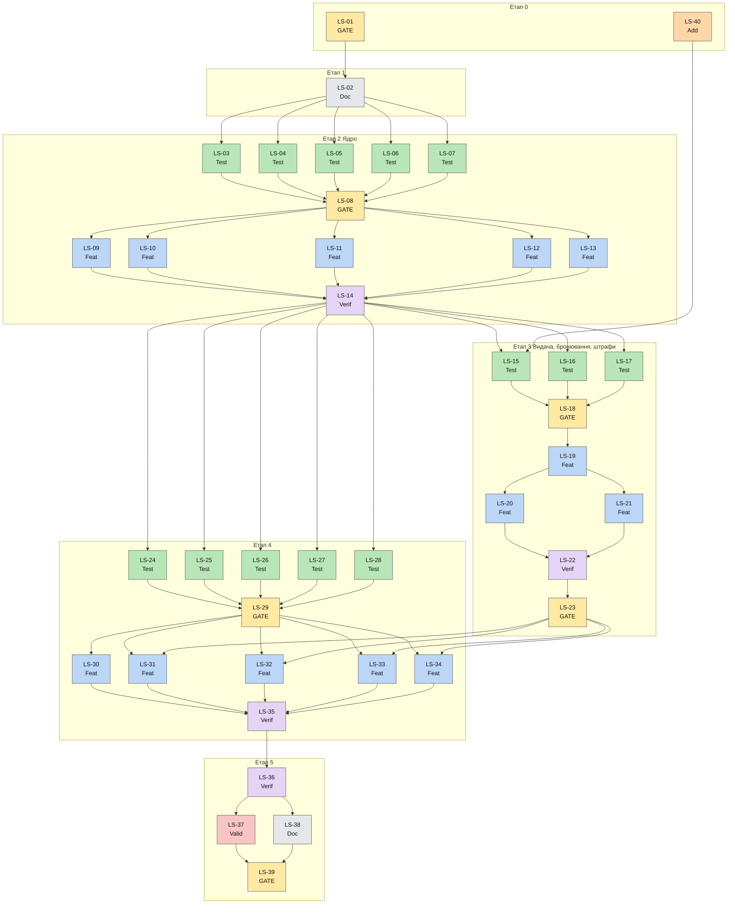

# Схема залежностей між тікетами

Жовтий — Gate, зелений — Test, синій — Feature, фіолетовий — Verification, червоний — Validation, сірий — Documentation, помаранчевий — Addendum. Показано скорочений граф (транзитивні зв'язки опущено).

