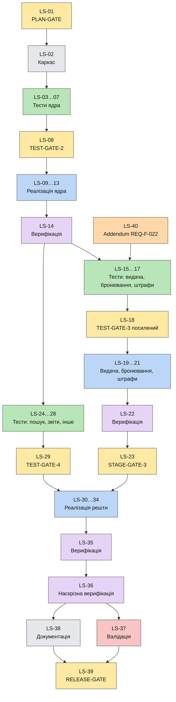

# Схема залежностей між тікетами

Скорочена схема: тікети одного етапу й типу об'єднано в один блок. Жовтий — Gate, зелений — Test, синій — Feature, фіолетовий — Verification, червоний — Validation, сірий — Documentation, помаранчевий — Addendum. Повний перелік зв'язків: `plan/tickets.md` (стовпець «Blocked by»).

