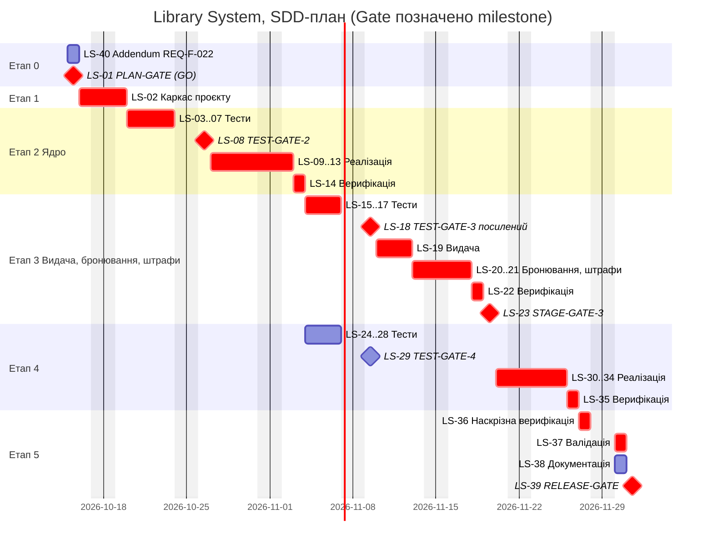

# Календарний план, критичний шлях та людський час (затверджено PLAN-GATE, кроки 9–12)

Допущення (редагуються студентом): старт 15.10.2026; робочі дні пн–пт;
тривалість у робочих днях; людина — один студент; агент виконує технічні
операції швидко, тому календарну тривалість визначають людські перегляди й
рішення Gate. Позначки LS-NN — з `plan/tickets.md` (номери Issues у `plan/issue-map.md`).

## 1. Етапи

| Етап | Тікети | Тривалість | Вихід |
|---|---|---|---|
| 0. Уточнення вимог | LS-40, LS-01 | 2 дні | Addendum до REQ-F-022; рішення PLAN-GATE |
| 1. Каркас | LS-02 | 2 дні | Стек, структура, запуск тестів |
| 2. Ядро | LS-03…14 | 11 днів | Каталог, акаунти, реєстрація, безпека, логування |
| 3. Видача, бронювання, штрафи | LS-15…23 | 9 днів | Основний бізнес-процес |
| 4. Решта функцій і НФВ | LS-24…35 | 5 днів після етапу 3 (тести 24–29 паралельно з етапом 3) | Пошук, звіти, рекомендації, сповіщення, НФВ |
| 5. Завершення | LS-36…39 | 3 дні | Верифікація, валідація, RELEASE-GATE |

Разом ≈ 35 робочих днів (≈ 7 тижнів).

## 2. Діаграма Ганта

## 3. Критичний шлях

LS-01 → LS-02 → LS-03…07 → LS-08 → LS-09…13 → LS-14 → LS-15…17 →
LS-18 → LS-19 → LS-20/21 → LS-22 → LS-23 → LS-30…34 → LS-35 → LS-36 →
LS-37 → LS-39 (≈ 35 робочих днів).

Затримка будь-якого з них зсуває завершення проєкту. Поза критичним шляхом
(є запас): LS-40 (має бути закритий до LS-15), LS-24…29 (тести та Gate етапу 4 виконуються паралельно з етапом 3)
і майже без запасу LS-38 (паралельний LS-37).

Обґрунтування (інструмент не рахує шлях автоматично): шлях побудовано
вручну за залежностями `Blocked by` з `plan/tickets.md`; тест → Gate →
реалізація → верифікація кожного етапу послідовні, а етап 3 блокує
звіти, рекомендації й сповіщення (залежать від видач).

## 4. Людський час (крок 12)

Оцінка годин, потрібних саме людині (перегляд, рішення). Технічну роботу
агента (≈ 30 год сумарно) календар майже не обмежує.

| Категорія | Тікети | Людина, год |
|---|---|---|
| Рішення Gate | LS-01 (2), 08 (2), 18 (4, посилений), 23 (2), 29 (2), 39 (1) | 13 |
| Перегляд тестів | етапи 2, 3, 4 | 9 |
| Перегляд diff реалізації | етапи 2, 3, 4 | 10 |
| Верифікація | LS-14, 22, 35, 36 (по 1,5) | 6 |
| Валідація | LS-37 | 3 |
| Addendum, документація | LS-40 (1), LS-02 (1), LS-38 (1) | 3 |
| **Разом** | | **44** |

Висновки:
- Людський час (≈ 44 год) перевищує технічний час агента. Вузьке місце — перегляд і Gate, а не генерація коду.
- План на 35 робочих днів збігається за темпом ≈ 1,3 год/день. При менших ресурсах (≈ 1 год/день) строк зростає до ≈ 44 днів.
- Найдорожчий тікет за людським часом — LS-18 (посилений TEST-GATE-3, 4 год), бо перевіряє фінансові вимоги.
- Рішення Gate і валідацію не можна прискорити делегуванням агенту (див. `plan/roles.md`).
