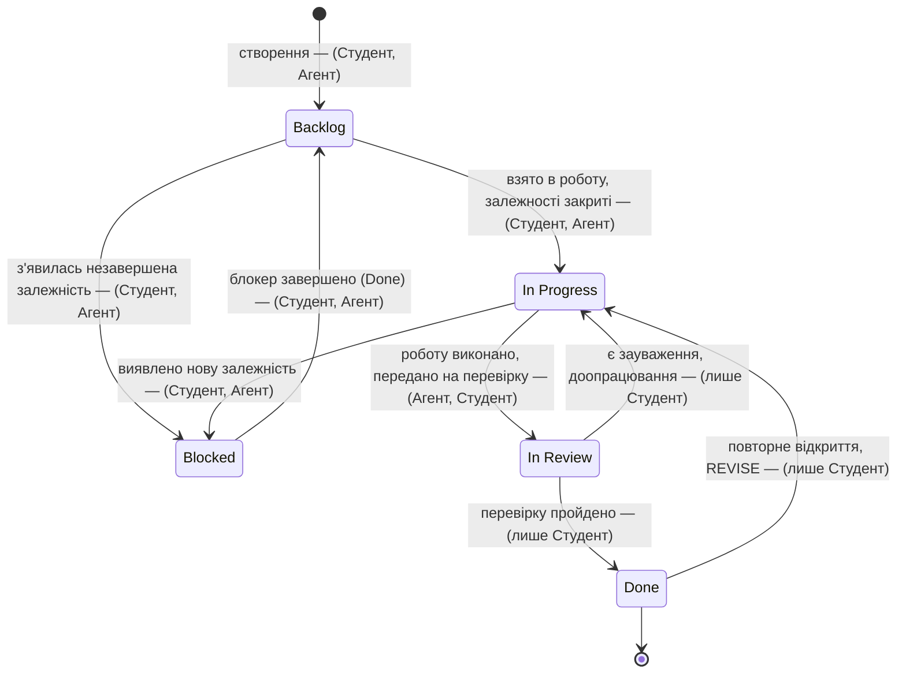

# Життєвий цикл задачі з ролями

Статуси відповідають колонкам дошки GitHub Project «Library System SDD».

Ролі проєкту:
- **Студент** — людина: власник проєкту, ухвалює рішення, перевіряє, закриває.
- **Агент** — кодинговий агент (Claude Code): виконує технічну роботу, пропонує, готує зведення; рішень Gate і валідації не ухвалює (`plan/roles.md`).

## Перехід за типами тікетів

| Перехід | Test, Feature, Documentation | Verification | Gate, Validation | Addendum, Specification |
|---|---|---|---|---|
| Створення (→ Backlog) | Студент, Агент | Студент, Агент | Студент, Агент | Студент, Агент |
| Backlog → In Progress | Студент, Агент | Студент, Агент | Студент (агент лише готує зведення) | Студент, Агент |
| In Progress → In Review | Агент, Студент | Агент, Студент | Студент | Агент (пропонує), Студент |
| In Review → Done | **Студент** | **Студент** | **Студент** (рішення GO/REVISE не делегується) | **Студент** |
| In Review → In Progress | Студент | Студент | Студент | Студент |
| Done → In Progress | Студент | Студент | Студент | Студент |

Правило: статус **Done** виставляє лише студент. Агент не закриває тікети
самостійно, а рішення Gate і валідацію не ухвалює ні за яких умов.
